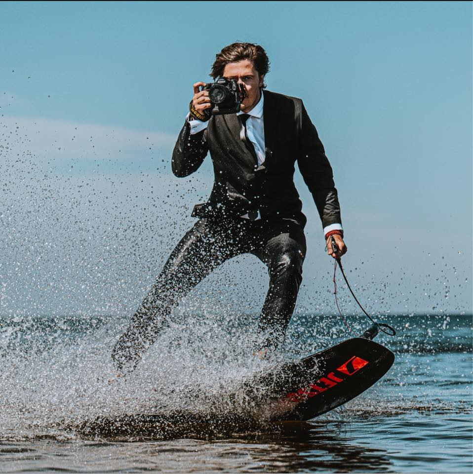

# Awesome Photography 

> A curated list of genuinely useful photography resources: learning, lighting, editing software, color management, business and licensing, communities and inspiration.

 Photo: Andrejs Zavadskis

Curated by [Andrejs Zavadskis](https://github.com/zavadskis), commercial, advertising, editorial and portrait photographer based in Riga, Latvia ([zavadskis.photo](https://zavadskis.photo/?utm_source=github&utm_medium=article&utm_campaign=bio)).

Free and open-source tools are listed first where possible. No affiliate links.

## Contents

- [Learning and Tutorials](#learning-and-tutorials)
- [Lighting](#lighting)
- [Portrait Photography](#portrait-photography)
- [Commercial and Advertising](#commercial-and-advertising)
- [Editorial and Photojournalism](#editorial-and-photojournalism)
- [Travel and Adventure](#travel-and-adventure)
- [Motorsport and Action](#motorsport-and-action)
- [Post-Processing and Editing Software](#post-processing-and-editing-software)
- [Color Management](#color-management)
- [Gear Reviews and Databases](#gear-reviews-and-databases)
- [Business and Licensing](#business-and-licensing)
- [Communities and Contests](#communities-and-contests)
- [Podcasts and YouTube](#podcasts-and-youtube)
- [Inspiration](#inspiration)
- [Open-Source Photo Tools on GitHub](#open-source-photo-tools-on-github)
- [Related Awesome Lists](#related-awesome-lists)
- [From the Author](#from-the-author)

## Learning and Tutorials

- [Cambridge in Colour](https://www.cambridgeincolour.com/tutorials.htm) - Clear, illustrated tutorials on exposure, optics, color and post-processing.
- [Photography Life](https://photographylife.com/) - In-depth articles on technique, landscape, wildlife and lens reviews.
- [Digital Photography School](https://digital-photography-school.com/) - Large library of beginner and intermediate tutorials.
- [Ted Forbes - The Art of Photography](https://theartofphotography.tv/) - Long-running video series on photographic history, craft and seeing.
- [PhotoPills Academy](https://www.photopills.com/academy) - Guides to planning sun, moon and Milky Way shots.
- [Depth of Field Calculator (DOFMaster)](https://www.dofmaster.com/dofjs.html) - Classic online depth-of-field and hyperfocal distance calculator.
- [Sunrise and Sunset Times (timeanddate)](https://www.timeanddate.com/sun/) - Sun position, golden hour and daylight data for any city.

## Lighting

Strobist, speedlight and studio lighting.

- [Strobist](https://strobist.blogspot.com/) - David Hobby's legendary blog that taught a generation to use small off-camera flashes.
- [Strobist Lighting 101](https://strobist.blogspot.com/2006/03/lighting-101.html) - The free foundational course on off-camera flash.
- [Profoto Academy](https://profoto.com/academy) - Free lighting tutorials and case studies from professional photographers.
- [Broncolor](https://www.broncolor.swiss/) - Swiss studio strobes, with lighting education and case studies.
- [Godox](https://www.godox.com/) - Affordable, widely used flash and strobe system with cross-brand triggers.
- [Lighting Diagram Creator](https://www.lightingdiagrams.com/) - Free online tool to sketch and share studio lighting setups.

## Portrait Photography

- [Peter Hurley](https://peterhurley.com/) - Headshot photographer known for teaching expression coaching ("squinch").
- [Annie Leibovitz at Vanity Fair](https://www.vanityfair.com/contributor/annie-leibovitz) - Iconic editorial portraits by one of the most influential portraitists.
- [National Portrait Gallery - Photographs](https://www.npg.org.uk/collections) - Searchable collection of historic and contemporary portraits.
- [Taylor Wessing Photographic Portrait Prize](https://www.npg.org.uk/photoportraitprize) - Major international portrait competition and exhibition.

## Commercial and Advertising

- [Communication Arts Photography](https://www.commarts.com/photography) - Annual showcase of the best advertising and editorial photography.
- [Lürzer's Archive](https://www.luerzersarchive.com/) - Curated archive of print advertising worldwide.
- [ASMP Business Resources](https://www.asmp.org/resources/) - Pricing, estimating and business practices from the American Society of Media Photographers.
- [Production Paradise](https://www.productionparadise.com/) - Directory of commercial photographers, producers and agents.

## Editorial and Photojournalism

- [World Press Photo](https://www.worldpressphoto.org/) - The leading photojournalism contest, archive and exhibition.
- [Lens Culture](https://www.lensculture.com/) - Contemporary photography magazine, awards and portfolio reviews.
- [The New York Times Lens Blog archive](https://lens.blogs.nytimes.com/) - Archive of the NYT blog on photojournalism and visual storytelling.
- [Reuters Pictures](https://www.reuters.com/news/pictures) - Breaking-news and feature photography from Reuters photographers.
- [The Atlantic In Focus](https://www.theatlantic.com/photo/) - Large-format photo essays on current events.
- [CPJ Safety Kit](https://cpj.org/safety-kit/) - Committee to Protect Journalists' physical and digital safety guidance.
- [NPPA Code of Ethics](https://nppa.org/resources/code-ethics) - The National Press Photographers Association's ethics code.

## Travel and Adventure

Planning tools and showcases for photography on the road.

- [National Geographic Photography](https://www.nationalgeographic.com/photography) - Stories and galleries from NatGeo's photographers.
- [Travel Photographer of the Year](https://www.tpoty.com/) - International travel photography awards and galleries.
- [PhotoPills](https://www.photopills.com/) - Planner app for sun, moon, Milky Way and time-lapse shots.
- [Windy](https://www.windy.com/) - Detailed weather and cloud forecasts for planning outdoor shoots.
- [Clear Outside](https://clearoutside.com/) - Cloud cover and astronomy forecast for night and landscape photographers.
- [Light Pollution Map](https://www.lightpollutionmap.info/) - Find dark skies for astrophotography.
- [Red Bull Illume](https://www.redbullillume.com/) - The image quest for action and adventure sports photography.

## Motorsport and Action

Rallies, racing and fast-moving subjects.

- [Getty Images Motorsport](https://www.gettyimages.com/collections/motorsports) - Motorsport photo archive including the historic LAT collection.
- [Dakar Rally - Official Media](https://www.dakar.com/en) - Official site of the Dakar Rally with stage photos and media information.
- [Gumball 3000](https://www.gumball3000.com/) - The international rally and lifestyle event, a magnet for automotive photographers.
- [Red Bull Content Pool](https://www.redbullcontentpool.com/) - Action-sports photography and video from Red Bull events.

## Post-Processing and Editing Software

Free and open-source tools first, then commercial.

### Free and Open Source

- [darktable](https://www.darktable.org/) - Open-source RAW developer and photo workflow application.
- [RawTherapee](https://www.rawtherapee.com/) - Powerful cross-platform open-source RAW processor.
- [ART (Another RawTherapee)](https://github.com/artpixls/ART) - Simplified fork of RawTherapee focused on ease of use.
- [GIMP](https://www.gimp.org/) - The GNU Image Manipulation Program for retouching and compositing.
- [digiKam](https://www.digikam.org/) - Professional open-source photo management with tagging and face recognition.
- [ExifTool](https://exiftool.org/) - The reference tool for reading and writing image metadata.
- [Hugin](https://hugin.sourceforge.io/) - Panorama stitching and HDR merging toolchain.
- [Siril](https://siril.org/) - Astronomical image processing for stacking deep-sky and Milky Way shots.
- [ImageMagick](https://imagemagick.org/) - Command-line suite for batch converting, resizing and watermarking.
- [vkdt](https://github.com/hanatos/vkdt) - Experimental GPU-accelerated RAW workflow by a darktable developer.
- [PIXLS.US](https://pixls.us/) - Community and tutorials for free and open-source photography software.

### Commercial

- [Adobe Lightroom](https://www.adobe.com/products/photoshop-lightroom.html) - Industry-standard cataloging and RAW editing.
- [Adobe Photoshop](https://www.adobe.com/products/photoshop.html) - The standard for retouching and compositing.
- [Capture One](https://www.captureone.com/) - Professional RAW editor favored for tethered studio shooting.
- [DxO PhotoLab](https://www.dxo.com/dxo-photolab/) - RAW editor with excellent noise reduction and optical corrections.
- [Affinity Photo](https://affinity.serif.com/photo/) - One-time-purchase alternative to Photoshop.
- [Photo Mechanic](https://home.camerabits.com/) - Fast ingest, culling and captioning tool used by news photographers.

## Color Management

- [X-Rite / Calibrite](https://calibrite.com/) - Display calibration hardware and ColorChecker targets.
- [DisplayCAL](https://displaycal.net/) - Open-source display calibration and profiling based on ArgyllCMS.
- [ArgyllCMS](https://www.argyllcms.com/) - Open-source color management system for displays, scanners and printers.
- [Color Management Guide (Cambridge in Colour)](https://www.cambridgeincolour.com/tutorials/color-management-printing.htm) - Plain-language introduction to color spaces and profiles.
- [ICC - International Color Consortium](https://www.color.org/) - The body behind the ICC profile standard, with technical resources.

## Gear Reviews and Databases

- [DPReview](https://www.dpreview.com/) - Camera and lens reviews, specs and news.
- [DXOMARK](https://www.dxomark.com/) - Lab-based sensor, lens and smartphone camera scores.
- [Lensfun Database](https://lensfun.github.io/) - Open database of lens corrections used by darktable and others.
- [LensRentals Blog](https://www.lensrentals.com/blog/) - Teardowns and optical bench tests by Roger Cicala and team.
- [Photons to Photos](https://www.photonstophotos.net/) - Sensor dynamic range and noise measurements.

## Business and Licensing

Copyright, metadata, model releases and protecting your work.

- [U.S. Copyright Office - Photographs](https://www.copyright.gov/registration/photographs/) - How to register photographs for copyright protection.
- [WIPO - Copyright](https://www.wipo.int/copyright/en/) - International copyright basics from the World Intellectual Property Organization.
- [Creative Commons Licenses](https://creativecommons.org/licenses/) - Understand and choose open licenses for your images.
- [PLUS Coalition](https://www.useplus.com/) - Picture Licensing Universal System for standardized image licensing terms.
- [IPTC Photo Metadata Standard](https://iptc.org/standards/photo-metadata/) - The standard for embedding creator, copyright and caption data in images.
- [Getty Images Release Forms](https://contributors.gettyimages.com/article/release-forms) - Model and property release templates and guidance from Getty Images.
- [Pixsy](https://www.pixsy.com/) - Find and act on unauthorized use of your photos online.

## Communities and Contests

- [r/photography](https://www.reddit.com/r/photography/) - Large Reddit community for photography discussion.
- [r/AskPhotography](https://www.reddit.com/r/AskPhotography/) - Friendly place to ask technical and gear questions.
- [Flickr](https://www.flickr.com/) - Long-standing photo-sharing community with groups and Creative Commons search.
- [500px](https://500px.com/) - Photo community and licensing marketplace.
- [Fstoppers](https://fstoppers.com/) - Tutorials, reviews and community photo contests.
- [PetaPixel](https://petapixel.com/) - Daily photography news and features.
- [Sony World Photography Awards](https://www.worldphoto.org/) - One of the largest free-to-enter photography competitions.
- [Hasselblad Masters](https://www.hasselblad.com/inspiration/masters/) - Prestigious award from Hasselblad.
- [Leica Oskar Barnack Award](https://www.leica-oskar-barnack-award.com/) - International award for photographic series about people and environment.
- [discuss.pixls.us](https://discuss.pixls.us/) - Forum for free software photographers and developers.

## Podcasts and YouTube

- [Sean Tucker](https://www.youtube.com/@seantucker) - Thoughtful videos on the creative process and photographic seeing.
- [Mads Peter Iversen](https://www.youtube.com/@madspeteriversen) - Landscape photography in the field.
- [Gavin Hoey](https://www.youtube.com/@gavinhoey) - Practical lighting and Photoshop tutorials.
- [Jamie Windsor](https://www.youtube.com/@JamieWindsor) - Essays on photography ideas, composition and style.
- [Nigel Danson](https://www.youtube.com/@NigelDanson) - Landscape technique and editing.
- [B&H Photo Video](https://www.youtube.com/@BandH) - Gear explainers and recorded talks by working professionals.
- [The Candid Frame](https://thecandidframe.com/) - Long-running podcast of conversations with photographers.

## Inspiration

Museums, agencies and archives worth getting lost in.

- [Magnum Photos](https://www.magnumphotos.com/) - The legendary photographers' cooperative and its archive.
- [VII Photo Agency](https://viiphoto.com/) - Photojournalism agency founded by leading war and documentary photographers.
- [Noor Images](https://www.noorimages.com/) - Documentary photography collective.
- [MoMA - Photography](https://www.moma.org/collection/terms/photography) - Museum of Modern Art's photography collection.
- [International Center of Photography](https://www.icp.org/) - Museum and school of photography in New York.
- [Fotografiska](https://www.fotografiska.com/) - Museums of contemporary photography in Stockholm, New York and more.
- [Foam Fotografiemuseum Amsterdam](https://www.foam.org/) - Amsterdam museum dedicated to photography.
- [Getty Museum - Photographs](https://www.getty.edu/art/collection/) - J. Paul Getty Museum collection including a major photography department.
- [Library of Congress - Prints & Photographs](https://www.loc.gov/pictures/) - Millions of historical photographs, many public domain.
- [Henri Cartier-Bresson Foundation](https://www.henricartierbresson.org/) - Archive and exhibitions of the master of the decisive moment.

## Open-Source Photo Tools on GitHub

- [PhotoPrism](https://github.com/photoprism/photoprism) - AI-powered self-hosted photo library.
- [Immich](https://github.com/immich-app/immich) - Self-hosted Google Photos alternative.
- [LibrePhotos](https://github.com/LibrePhotos/librephotos) - Self-hosted photo management with face recognition.
- [darktable source](https://github.com/darktable-org/darktable) - Source code of the darktable RAW developer.
- [RawTherapee source](https://github.com/Beep6581/RawTherapee) - Source code of RawTherapee.
- [LibRaw](https://github.com/LibRaw/LibRaw) - Library for reading RAW files from digital cameras.
- [rawpy](https://github.com/letmaik/rawpy) - Python wrapper for LibRaw.
- [Phockup](https://github.com/ivandokov/phockup) - Organize photos and videos into folders by date.
- [Elodie](https://github.com/jmathai/elodie) - EXIF-based photo organizer and workflow tool.
- [gphoto2](https://github.com/gphoto/gphoto2) - Command-line camera control and tethered capture.
- [Entangle](https://gitlab.com/entangle/entangle) - Tethered shooting application for Linux.
- [Czkawka](https://github.com/qarmin/czkawka) - Find duplicate and similar images in large archives.
- [Lychee](https://github.com/LycheeOrg/Lychee) - Self-hosted photo management and gallery.
- [Piwigo](https://github.com/Piwigo/Piwigo) - Open-source photo gallery software for the web.
- [rclone](https://github.com/rclone/rclone) - Sync and back up photo archives to cloud storage.

## Related Awesome Lists

- [awesome](https://github.com/sindresorhus/awesome) - The list of awesome lists.
- [awesome-selfhosted](https://github.com/awesome-selfhosted/awesome-selfhosted) - Self-hosted software, including photo galleries.
- [awesome-opensource-photography](https://github.com/ibaaj/awesome-OpenSourcePhotography) - Free and open-source photography software.
- [awesome-stock-resources](https://github.com/neutraltone/awesome-stock-resources) - Free stock photos, videos and illustrations.

## From the Author

I have been photographing since 2004: Forbes USA editorial portraits, advertising campaigns, the Dakar Rally, Formula 1 in Singapore, five Gumball 3000 rallies and an expedition to the summit of Kilimanjaro. This list collects the resources I actually use and recommend. If you want to see how some of those jobs were shot, these write-ups go behind the scenes:

- [Forbes Daily Covers: Portraits of Billionaires Across Europe](https://blog.zavadskis.eu/forbes-daily-covers-portraits-of-billionaires-across-europe/?utm_source=github&utm_medium=article&utm_campaign=bio)
- [Dakar Rally in Saudi Arabia: Bivouac, Sand and a Crash](https://blog.zavadskis.eu/dakar-rally-in-saudi-arabia-bivouac-sand-and-a-crash/?utm_source=github&utm_medium=article&utm_campaign=bio)
- [Kilimanjaro Climb: Photographing the Ascent to Uhuru Peak](https://blog.zavadskis.eu/kilimanjaro-climb-photographing-the-ascent-to-uhuru-peak/?utm_source=github&utm_medium=article&utm_campaign=bio)
- [Photo Archive Backup: How I Keep 500 TB of Images Safe](https://blog.zavadskis.eu/photo-archive-backup-how-i-keep-500-tb-of-images-safe/?utm_source=github&utm_medium=article&utm_campaign=bio)
- [Photo Spots in Latvia: Free Map of 430+ Locations](https://blog.zavadskis.eu/photo-spots-in-latvia-free-map-of-430-locations/?utm_source=github&utm_medium=article&utm_campaign=bio)

More of my work:

- [Instagram @zavadskis](https://instagram.com/zavadskis) - Recent assignments, travel and everyday frames.
- [blog.zavadskis.eu](https://blog.zavadskis.eu/?utm_source=github&utm_medium=article&utm_campaign=bio) - Articles on gear, technique and assignments.
- [fotoblog.zavadskis.eu](https://fotoblog.zavadskis.eu/?utm_source=github&utm_medium=article&utm_campaign=bio) - Photo stories and archive: Riga, portraits, events, brands, rallies and travel.
- [zavadskis.photo](https://zavadskis.photo/?utm_source=github&utm_medium=article&utm_campaign=bio) - Portfolio of commercial, advertising, editorial and portrait work.
- [ProPortfolio.pro](https://proportfolio.pro/?utm_source=github&utm_medium=article&utm_campaign=bio) - A platform I founded in 2026 that connects photographers, videographers, models, stylists, studios and other creative professionals.

## Contributing

Suggestions are welcome. Please read the [contribution guidelines](CONTRIBUTING.md) before opening a pull request.
